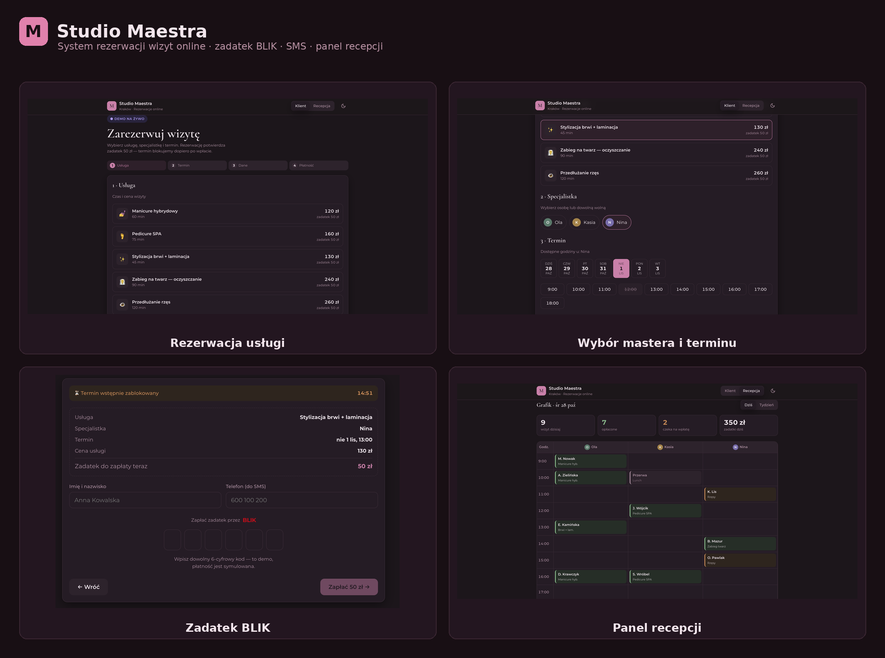

# System rezerwacji wizyt — demo

Interaktywny prototyp systemu rezerwacji online dla gabinetu kosmetycznego (6 stanowisk).
Zbudowany jako samodzielna strona, bez abonamentu i prowizji od wizyt.

**🔗 Demo na żywo:** https://matviiovcharenko415.github.io/rezerwacje-studio/

## Funkcje

- **Rezerwacja** — wybór usługi, specjalistki i terminu; slot blokowany na 15 minut
- **Zadatek BLIK** — termin potwierdza się dopiero po wpłacie (koniec z pustymi wizytami)
- **SMS** — potwierdzenie od razu + automatyczne przypomnienie 24h przed wizytą
- **Panel recepcji (PWA)** — grafik dnia, statusy *opłacone / czeka na wpłatę*, podsumowanie zadatków
- Tryb jasny i ciemny, responsywny (mobile-first)

## Stack docelowy

Next.js · TypeScript · PostgreSQL · integracja operatora płatności (Tpay / Przelewy24) · SMSAPI.pl

> To demo frontendowe — płatności i SMS są symulowane. Wersja produkcyjna łączy się z realnym operatorem płatności i bramką SMS.

---

### English

Interactive prototype of an online booking system for a beauty studio: service/specialist/slot selection, BLIK deposit to confirm a slot, SMS confirmation + 24h reminder, and a reception PWA panel. Frontend demo — payments and SMS are simulated.
